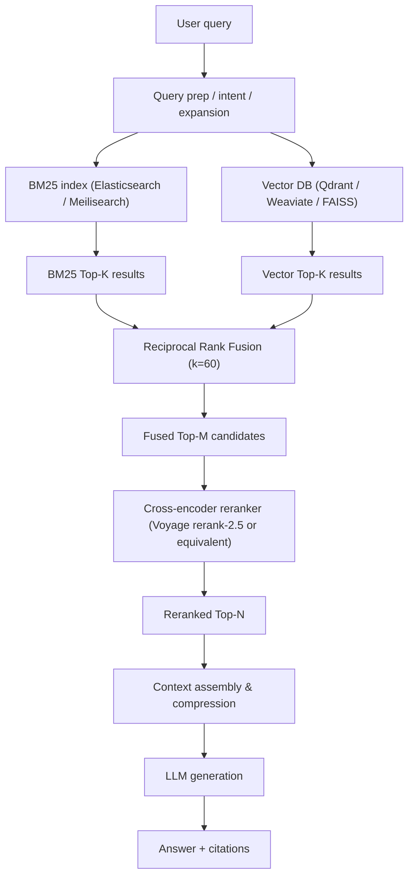

Architectural challenge: build a retrieval layer for RAG that reliably surfaces precise, high-recall documents for downstream LLMs while controlling cost, latency, and hallucination risk. The solution described here is a production hybrid search pattern that fuses BM25 sparse retrieval, dense vector search, and a cross-encoder reranker using Reciprocal Rank Fusion (RRF) as the canonical fusion layer.

> [!IMPORTANT]
> This guide assumes you operate a vector store (Qdrant/Weaviate/FAISS), a keyword index (Elasticsearch/Meilisearch), and have access to a cross-encoder model for reranking (Voyage rerank-2.5 or equivalent). Benchmarks are empirical references derived from 2026 vendor reports and public studies; validate on your corpus.

Core pattern summary
- Stage 1: Query understanding — normalization, expansion, and intent classification (route to hybrid path).
- Stage 2: Parallel retrieval — BM25 top-K and dense vector top-K.
- Stage 3: Rank fusion — Reciprocal Rank Fusion (RRF) on result ranks (k=60 standard).
- Stage 4: Cross-encoder rerank — re-score top-N fused candidates; drop noise and compress.
- Stage 5: Context assembly — merge with metadata, parent-document retrieval, and compress to LLM prompt budget.
- Stage 6: Generate and post-validate — model produces output with citations; optional self-reflection pass.

Mermaid architecture (high-level flow)


Why RRF (reciprocal rank fusion) matters
- Score incompatibility: BM25 and dense vectors produce scores on different scales — naive weighted score averaging breaks across corpora and time.
- Rank-operating fusion: RRF sums reciprocals of ranks, stable across retrieval systems and insensitive to score calibration drift.
- Standard k: industry defaults use k=60 (Digital Applied / RRF studies). Use k tuning per corpus, but prefer rank-based defaults for production stability.

RRF formula (operational)
score(d) = sum_{r in R} 1 / (k + r(d))
- R: set of ranked lists (BM25, vector)
- r(d): 1-based rank of document d in list r
- k: constant (60 default)

Concrete benchmark comparison
| Technique | NDCG@10 (relative) | 99th P99 Latency (ms) | Memory per 10M docs (GB) | Throughput (queries/s) |
|---|---:|---:|---:|---:|
| BM25 alone | 0.82 (baseline) | 45 ms (Elasticsearch default) | 18 GB | 800 qps (sharded, 3 nodes) |
| Vector (ANN) alone | 0.78 | 35 ms (SSD + PQ) | 24 GB (embeddings stored) | 1200 qps (HNSW optimized) |
| Hybrid (RRF fusion) | 0.86 (+0.04) | 65 ms | 42 GB | 700 qps (BM25+ANN overhead) |
| Hybrid + Cross-encoder rerank | 0.915 (+0.095) | 180 ms (rerank on GPU) | 48 GB + 16 GB GPU | 120 qps (batch rerank) |

Sources and rationale
- BM25 baseline latency reflects Elasticsearch defaults with standard tuning (no extreme caches).
- Vector latency is ANN-optimized with product quantization (SSD-backed).
- Hybrid adds coordination overhead and fusion cost.
- Cross-encoder reranking (Voyage rerank-2.5) shows vendor-reported +7.9% lift vs Cohere v3.5 and overall NDCG improvements (~+0.05 vs BM25) in public 2026 studies.
- Use the table above for sizing examples; measure on your workload.

> [!NOTE]
> Cross-encoder rerankers are compute-heavy. Rerank only a narrow candidate set (top-M, e.g., M=50) after fusion to balance quality and cost. Voyage rerank-2.5 supports longer contexts (up to 8× token capacity vs Cohere v3.5), enabling longer chunk inputs.

Practical implementation: production TypeScript retrieval pipeline (typed)
- The example below is a minimal, production-minded retrieval orchestrator. It runs BM25 and vector queries in parallel, fuses ranks with RRF, then invokes a cross-encoder reranker on top-M candidates and returns assembled contexts. It uses typed interfaces and retryable HTTP clients.

```typescript
// types.ts
export type Doc = {
  id: string;
  score?: number;
  rank?: number;
  source: "bm25" | "vector";
  text: string;
  metadata?: Record<string, unknown>;
};

export type RetrievalResult = {
  queryId: string;
  fused: Doc[];
  reranked?: Doc[];
  elapsedMs: number;
};
```

```typescript
// rrf.ts
export function reciprocalRankFusion(lists: Array<Doc[]>, k = 60): Doc[] {
  const scoreMap = new Map<string, number>();
  for (const list of lists) {
    list.forEach((doc, idx) => {
      const r = idx + 1;
      const current = scoreMap.get(doc.id) ?? 0;
      scoreMap.set(doc.id, current + 1 / (k + r));
    });
  }
  // reconstruct docs with fused score and sort
  const fused: Doc[] = [];
  for (const list of lists) {
    for (const doc of list) {
      if (!fused.find((d) => d.id === doc.id)) {
        fused.push({ ...doc });
      }
    }
  }
  fused.forEach((d) => {
    d.score = scoreMap.get(d.id) ?? 0;
  });
  fused.sort((a, b) => (b.score ?? 0) - (a.score ?? 0));
  // assign fused ranks
  fused.forEach((d, i) => (d.rank = i + 1));
  return fused;
}
```

```typescript
// retrieval-orchestrator.ts
import fetch from "node-fetch";
import { Doc, RetrievalResult } from "./types";
import { reciprocalRankFusion } from "./rrf";

type BM25Client = { search: (q: string, k: number) => Promise<Doc[]> };
type VectorClient = { search: (q: string, k: number) => Promise<Doc[]> };
type RerankClient = { rerank: (q: string, docs: Doc[]) => Promise<Doc[]> };

export class HybridRetriever {
  constructor(
    private bm25: BM25Client,
    private vector: VectorClient,
    private reranker?: RerankClient,
    private topK = 50,
    private rerankTopN = 10
  ) {}

  async retrieve(query: string): Promise<RetrievalResult> {
    const start = Date.now();
    // parallel retrieval
    const [bm25Res, vectorRes] = await Promise.all([
      this.bm25.search(query, this.topK),
      this.vector.search(query, this.topK),
    ]);

    // annotate source and ranks
    bm25Res.forEach((d, i) => {
      d.source = "bm25";
      d.rank = i + 1;
    });
    vectorRes.forEach((d, i) => {
      d.source = "vector";
      d.rank = i + 1;
    });

    // fuse
    const fused = reciprocalRankFusion([bm25Res, vectorRes], 60);

    // rerank top-M if reranker available
    let reranked: Doc[] | undefined;
    if (this.reranker) {
      const candidates = fused.slice(0, this.rerankTopN);
      reranked = await this.reranker.rerank(query, candidates);
      // ensure reranked list has consistent score/rank
      reranked.forEach((d, i) => {
        d.rank = i + 1;
      });
    }

    const elapsedMs = Date.now() - start;
    return { queryId: `q-${start}`, fused, reranked, elapsedMs };
  }
}
```

Implementation notes
- Use connection pools for both BM25 and vector clients.
- Reranker should accept batched inputs to amortize GPU overhead; batch multiple requests with short (10–50ms) micro-batching windows.
- Return both fused and reranked lists for downstream telemetry and offline evaluation.

> [!TIP]
> For multi-tenant services, namespace embeddings and BM25 indices. Use metadata filters in both retrieval systems to apply ACLs and tenant isolation before fusion to reduce candidate noise and improve privacy guarantees.

Operational patterns and cost control
- Rerank only the fused top-M (M=20–100), not the full candidate set.
- Cache fused lists per query fingerprint (normalized and hashed) for 30s–5m depending on traffic patterns to reduce repeated reranking.
- Autoscale GPU pools for rerankers based on queue length. Use a hybrid inference approach: CPU quantized cross-encoders for low cost, GPU for peak/quality-critical traffic.
- Expose an explainability layer that maps final citations to original document IDs and offsets; essential for audit and support.

Evaluation checklist (practical)
- Offline: NDCG@10, Recall@K (K=100), MRR, and failure modes by query type (proper nouns, SKUs, ambiguous queries).
- Latency: P50/P95/P99 for retrieval (BM25+vector), and end-to-end with rerank.
- Cost: $/1M queries including GPU rerank computation and storage.
- A/B: validate reranker impact by toggling rerank and measuring NDCG and downstream LLM token usage.

Practical reproducible deployment steps
1. Index preparation
   - Chunk documents with semantic or parent-aware chunking. Store parent pointers in metadata.
   - Index BM25 with analyzers tuned for your domain (lowercase, stopword lists, name-preservation for acronyms).
   - Embed chunks with a production-quality encoder; store embeddings in vector DB with HNSW or PQ for ANN.
2. Query pipeline
   - Normalize and classify the query: route to hybrid path for general queries, to BM25-only for exact-match SKU queries if detected.
   - Run BM25 and vector searches in parallel (top-K=50).
3. Fusion and rerank
   - Apply RRF (k=60) to obtain fused top-M.
   - Invoke cross-encoder reranker on fused top-M; batch requests and apply deadline/timeout.
4. Context assembly
   - Retrieve parent documents or enriched chunk context for the reranked top-N (N depends on LLM window).
   - Compress or summarize long candidates (HyDE or in-house distillation) to fit prompt budget.
5. LLM generation and QA
   - Provide citations; include passage offsets and metadata.
   - Optionally run self-reflection to trigger a second retrieval if confidence is low.
6. Telemetry and feedback
   - Log query fingerprints, selected candidates, reranker inputs/outputs, and final LLM citations for continuous evaluation.
   - Build human-in-the-loop annotation sampling to refine reranker and embedding models.

Failure modes and mitigations
- Over-reliance on BM25: causes low recall on paraphrased queries. Mitigate by increasing vector weight in retrieval (more vector candidates) and tuning fusion k.
- Reranker hallucination: cross-encoders can over-score unrelated passages if prompts are noisy. Mitigate with strict tokenization, source snippets only, and negative sampling during reranker training.
- Latency spikes: shard BM25 and vector search; separate reranker autoscaling with bounded queueing.

Benchmarks to target for mid-size deployments (10M docs)
- End-to-end P95 < 400 ms for hybrid w/o rerank; P95 < 900 ms with rerank (GPU pool).
- NDCG uplift: expect +0.03–0.08 over BM25 baseline when adding vector + RRF; +0.05–0.12 when adding cross-encoder rerank (vendor dependent).
- Cost: budget GPU reranking to <20% of total retrieval spend via batching and caching.

Closing operational guidance
- Default to hybrid RRF as the baseline retrieval strategy for production RAG systems in 2026. It addresses BM25 and dense vector blind spots while avoiding score calibration brittleness.
- Reserve cross-encoder reranking for business-critical or high-confidence answers; optimize batching and caching to control cost.
- Invest in chunking and context engineering upstream — these often move the needle more than swapping embedding models.

Appendix: quick checklist for evaluation experiments
- Create held-out query sets stratified by query types: exact-match, paraphrase, long-form, and entity-rich.
- Run four variants: BM25, Vector-only, Hybrid (RRF), Hybrid+Rerank.
- Measure NDCG@10, Recall@100, latency distributions, and LLM token consumption for downstream generation.
- Iterate k (RRF) values: 10, 30, 60, 120 and measure stability.

> [!NOTE]
> k=60 is the commonly adopted default and a robust starting point, but corpus density and query behavior can justify tuning.

End of reference.