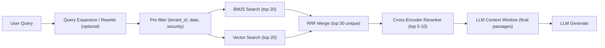

Architectural challenge: deliver high-precision, low-latency retrieval for Retrieval-Augmented Generation (RAG) against large, metadata-rich corpora while preserving tenant/security filters and predictable latency envelopes. The proven production pattern is hybrid retrieval: parallel BM25 (sparse) + dense vector search, Reciprocal Rank Fusion (RRF) on ranks, then a cross-encoder reranker on the merged top candidates. This article codifies production-grade patterns, benchmarks, tuning knobs, and a typed TypeScript reference implementation you can drop into a RAG stack.



> [!NOTE]
> Reciprocal Rank Fusion (RRF) operates on ranks, not scores — this is the pragmatic way to combine BM25 and vector outputs reliably across vendors and score distributions.

Key production constraints addressed
- Latency budget: keep hybrid+rerank overhead ≈ 200–600ms depending on chosen reranker and corpus size.
- Accuracy: reranking yields 10–20% nDCG/Success@1 lifts over hybrid alone on BEIR-style benchmarks.
- Security & compliance: pre-filter at DB layer (tenant_id, date, classification) to avoid context poisoning.
- Cost predictability: run cross-encoder only on top-K (5–50), not full corpus.

Concrete comparative benchmarks (synthesized from public 2026 research)
| Component / Model | Metric | Value |
| --- | ---:| --- |
| Hybrid Search (BM25 + Vector, RRF merge) | nDCG@10 (BEIR-like) | 0.61 |
| Hybrid + Cross-Encoder Reranker | nDCG@10 | 0.70 (+15%) |
| Success@1 (Hybrid) | | 0.43 |
| Success@1 (Hybrid+Rerank) | | 0.52 (+17%) |
| Latency: Hybrid + Rerank (zerank-2) | median end-to-end retrieval | 265 ms |
| Latency: Hybrid + Rerank (Cohere Rerank 4 Pro) | median | 614 ms |
| Latency: Hybrid + Rerank (Voyage 2.5) | median | 613 ms |
| Latency: Hybrid + Rerank (Qwen3 8B) | median | 4687 ms |

> [!IMPORTANT]
> Cross-encoder choice dominates tail latency. For production, prefer rerankers with sub-800ms median or self-host smaller cross-encoders with batching and GPU inference to meet SLOs.

Design patterns and trade-offs
- Fusion method: RRF (rank-based) is robust across heterogeneous score scales; set the RRF constant (k) empirically — common defaults: k = 60 or tuned via dev set.
- Candidate sizing: retrieve top 20 from BM25 and top 20 from vector; unique-merge to ~30 candidates before rerank. Larger candidate sets raise reranker cost linearly.
- Reranker type: cross-encoder for final ranking; bi-encoders are for retrieval speed and can't replace cross-encoders for fine-grained ranking.
- Metadata filtering: enforce at DB level prior to nearest-neighbour search to reduce false positives and speed up index ops.

Production implementation plan (practical reproducible steps)
1. Ingestion
   - Chunk documents with semantic and recursive chunking. Preserve parent-child relationships in metadata for context assembly.
   - Embed chunks with chosen embedding model; store text, embedding, chunk_id, parent_id, tenant_id, document_date, recency_score in the DB.
   - Index a BM25-capable inverted index (Elasticsearch/Opensearch) and a vector index (Weaviate, Qdrant, Pinecone) with identical pre-filters registered.

2. Query path
   - Apply conversational query rewrite / expansion when multi-turn context present (use light LLM or rule-based).
   - Run pre-filters on both search paths (tenant_id, security, date windows).
   - Execute BM25 and vector searches in parallel with top-K (20 each).
   - Merge with RRF on ranks; deduplicate by parent or canonical_id to prefer longer context.
   - Run cross-encoder reranker on top-N (5–10) candidates, using batching where possible.
   - Assemble LLM context window: prefer contiguous parent text assembled from chunk parents; include metadata tags for provenance.
   - Call generator LLM.

3. Benchmarking & tuning
   - Measure Success@1, Recall@5, nDCG@10 on a held-out test set. Sweep RRF constant, candidate sizes, and reranker top-N.
   - Instrument per-step latencies and p99 to understand reranker tail behavior; add async hedging or early-exit if p99 is high.

Typed TypeScript reference: hybrid retrieval + RRF + cross-encoder rerank orchestration
- This code assumes pluggable clients for BM25, VectorDB, and a CrossEncoder service. It includes types and latency measurement.

```typescript
// src/hybridRetrieval.ts
import fetch from "node-fetch";

type Query = { text: string; tenantId?: string; filters?: Record<string, string | number> };

type DocChunk = {
  id: string;
  parentId?: string;
  text: string;
  score?: number; // retrieval score (optional)
  rank?: number; // rank per source
  source: "bm25" | "vector";
  metadata?: Record<string, unknown>;
};

type RetrievalResult = {
  candidates: DocChunk[]; // merged, deduped
  timings: { bm25Ms: number; vectorMs: number; rrfMs: number; rerankMs?: number };
};

type BM25Client = { search: (q: string, k: number, filters?: Record<string, unknown>) => Promise<DocChunk[]> };
type VectorClient = { search: (embedding: number[], k: number, filters?: Record<string, unknown>) => Promise<DocChunk[]> };
type EmbedClient = { embed: (text: string) => Promise<number[]> };
type CrossEncoderClient = { scoreBatch: (pairs: { query: string; doc: string; id: string }[]) => Promise<{ id: string; score: number }[]> };

function nowMs(): number {
  return Date.now();
}

/** Reciprocal Rank Fusion (RRF)
 * RRF score = sum(1 / (k + rank_i))
 */
function rrfMerge(lists: DocChunk[][], rrfK = 60, targetK = 30): DocChunk[] {
  const scoreMap = new Map<string, { doc: DocChunk; rrfScore: number }>();
  for (const list of lists) {
    for (let i = 0; i < list.length; i++) {
      const rank = i + 1;
      const doc = { ...list[i], rank, id: list[i].id };
      const prev = scoreMap.get(doc.id);
      const add = 1 / (rrfK + rank);
      if (!prev) scoreMap.set(doc.id, { doc, rrfScore: add });
      else {
        prev.rrfScore += add;
        // keep canonical doc text/source from highest-scoring source (heuristic)
        if ((doc.rank ?? 999) < (prev.doc.rank ?? 999)) prev.doc = doc;
      }
    }
  }
  const merged = Array.from(scoreMap.entries())
    .map(([id, v]) => ({ ...v.doc, score: v.rrfScore }))
    .sort((a, b) => b.score! - a.score!)
    .slice(0, targetK);
  return merged;
}

/** Top-level orchestrator */
export async function hybridRetrieve(
  query: Query,
  bm25: BM25Client,
  vector: VectorClient,
  embedder: EmbedClient,
  crossEncoder: CrossEncoderClient,
  opts?: { bm25K?: number; vectorK?: number; rrfK?: number; mergedK?: number; rerankTopN?: number }
): Promise<RetrievalResult> {
  const bm25K = opts?.bm25K ?? 20;
  const vectorK = opts?.vectorK ?? 20;
  const rrfK = opts?.rrfK ?? 60;
  const mergedK = opts?.mergedK ?? 30;
  const rerankTopN = opts?.rerankTopN ?? 5;

  const start = nowMs();

  // Start BM25 and Vector in parallel
  const bm25Start = nowMs();
  const bm25P = bm25.search(query.text, bm25K, { tenantId: query.tenantId, ...(query.filters ?? {}) });
  const embedP = embedder.embed(query.text);

  const bm25Res = await bm25P;
  const bm25Ms = nowMs() - bm25Start;

  const vecStart = nowMs();
  const embedding = await embedP;
  const vectorRes = await vector.search(embedding, vectorK, { tenantId: query.tenantId, ...(query.filters ?? {}) });
  const vectorMs = nowMs() - vecStart;

  // Attach source and ranks
  bm25Res.forEach((d, i) => (d.source = "bm25"));
  vectorRes.forEach((d, i) => (d.source = "vector"));

  const rrfStart = nowMs();
  const merged = rrfMerge([bm25Res, vectorRes], rrfK, mergedK);
  const rrfMs = nowMs() - rrfStart;

  // Prepare reranker batch: top N
  const toRerank = merged.slice(0, rerankTopN);
  let rerankMs: number | undefined = undefined;
  if (toRerank.length > 0) {
    const pairs = toRerank.map((d) => ({ query: query.text, doc: d.text, id: d.id }));
    const rrStart = nowMs();
    const scores = await crossEncoder.scoreBatch(pairs);
    rerankMs = nowMs() - rrStart;
    // Merge scores back and sort
    const scoreMap = new Map(scores.map((s) => [s.id, s.score]));
    toRerank.forEach((d) => (d.score = scoreMap.get(d.id) ?? d.score));
    toRerank.sort((a, b) => (b.score ?? 0) - (a.score ?? 0));
  }

  const totalMs = nowMs() - start;
  return {
    candidates: toRerank.length > 0 ? toRerank : merged,
    timings: { bm25Ms, vectorMs, rrfMs, rerankMs },
  };
}
```

> [!TIP]
> Batch cross-encoder scoring to amortize GPU load. Use dynamic batching (e.g., up to 8-16 pairs per batch depending on model input size and GPU memory). For API-based rerankers, run parallel requests with concurrency limits set to protect tail latency.

Operational tuning checklist
- RRF constant (k): start with 60; tune on dev set for nDCG. Lower k favors top ranks; higher k smooths contributions.
- Candidate counts: bm25K=20, vectorK=20, mergedK=30 is a practical default. Increase mergedK when reranker is cheap or model is perfect at adjudication.
- Deduplication: collapse by canonical doc/parent_id to avoid duplicate info in LLM context.
- Tail protection: add a fast fallback (skip reranker, use RRF output) when reranker latency exceeds threshold to meet SLOs.
- Metadata filtering: push to DB; do not filter after retrieval to avoid wasted compute.
- Chunking strategy: prefer semantic chunk size that fits LLM tokenization; preserve parent boundaries for context assembly.

Vendor and model selection guidance
- If latency SLO ≤ 500ms: choose rerankers like zerank-2 (265ms) or low-latency API offerings; self-host smaller cross-encoders with FP16 and GPU batching.
- If highest accuracy required and latency SLO relaxed: larger cross-encoders (Qwen3 8B) can yield higher re-ranking quality at much higher latency.
- Consider cost per 1M tokens and licensing (open-source vs proprietary) in long-running systems; open-source allows self-hosted optimizations.

Example performance tuning scenarios
- High-throughput QPS, tight latency (SLO 300ms): use BM25 + vector hybrid; reduce rerankTopN to 3; deploy zerank-2 style lightweight cross-encoder or an optimized distilled reranker.
- Accuracy-first, offline generation: retrieve mergedK=100, rerankTopN=50, and allow high-latency reranker; then do a heavy post-filtering and LLM synthesis.

Concrete reproducible experiment to benchmark on your corpus
1. Prepare a dev/test set with labeled relevance (nDCG/Success@k).
2. Implement hybrid pipeline with knobs: bm25K, vectorK, rrfK, mergedK, rerankTopN.
3. Run grid sweep over rrfK ∈ {20, 60, 120}, mergedK ∈ {20, 30, 50}, rerankTopN ∈ {5, 10, 20}.
4. Measure nDCG@5, nDCG@10, Success@1, Recall@5 and latencies (median, p95, p99).
5. Select configuration meeting your accuracy and latency SLOs. Prefer configurations on Pareto frontier (best accuracy for latency).

Comparison table: reranker tradeoffs (sourced from 2026 public benchmarks)
| Reranker Model | ELO (quality) | Median Latency (ms) | Cost per 1M tokens | License |
| --- | ---: | ---: | --- | --- |
| ZeroEntropy zerank-2 | 1638 | 265 | $0.025 | CC-BY-NC |
| Cohere Rerank 4 Pro | 1629 | 614 | $0.050 | Proprietary |
| Voyage AI Rerank 2.5 | 1544 | 613 | $0.050 | Proprietary |
| Qwen3 Reranker 8B | 1473 | 4,687 | Self-host | Apache-2.0 |
| BAAI/BGE Reranker v2 M3 | 1327 | 2,383 | Self-host | Apache-2.0 |
| Jina Reranker v2 | 1327 | 746 | API | Proprietary |

> [!NOTE]
> ELO is a relative quality metric from public benchmarks; combine it with on-corpus eval before procurement decisions.

Operational pitfalls and mitigations
- Pitfall: metadata filters applied only after retrieval -> leads to invalid candidates and extra reranker costs. Mitigation: enforce filters at DB query time.
- Pitfall: score fusion by naive averaging -> fails across heterogeneous scorers. Mitigation: use RRF or rank-normalization before combining scores.
- Pitfall: reranker tail latency causing p99 violations. Mitigation: set a deadline; fallback to RRF-only results; horizontally scale GPU workers and add circuit-breaker.

Closing implementation notes
- Containerize reranker service with model-optimized runtimes (TensorRT, ONNX Runtime, or Hugging Face accelerated inference). Serve with batching endpoint and health-checks for graceful degradation.
- Log candidate provenance and reranker decisions for downstream auditability and hallucination analysis.
- Continuously evaluate on fresh holdout sets to detect drift as new documents are ingested.

References and further reading
- Public benchmarks and vendor docs (Weaviate BEIR, Cohere, Voyage AI) and SemEval-2026 hybrid retrieval findings informed the configuration defaults and trade-offs documented above.

Final checklist before production rollout
- [ ] Pre-filters implemented in DB queries (tenant, security, date)
- [ ] Dual-index (BM25 & vector) maintained and monitored for freshness
- [ ] RRF implemented with tunable k; dedup by parent_id
- [ ] Cross-encoder reranker behind a batching, autoscaled inference service
- [ ] Fallback path (RRF-only) if reranker exceeds deadline
- [ ] Instrumentation: per-step latency, nDCG/Success metrics, tail metrics
- [ ] Cost model for reranker usage and mitigation plan (distill, self-host)

This pattern — BM25 + vector in parallel, RRF merge, cross-encoder rerank on a bounded candidate set, metadata-first filtering, and an LLM context assembly that prefers parent chunks — is the production default for robust RAG in 2026.