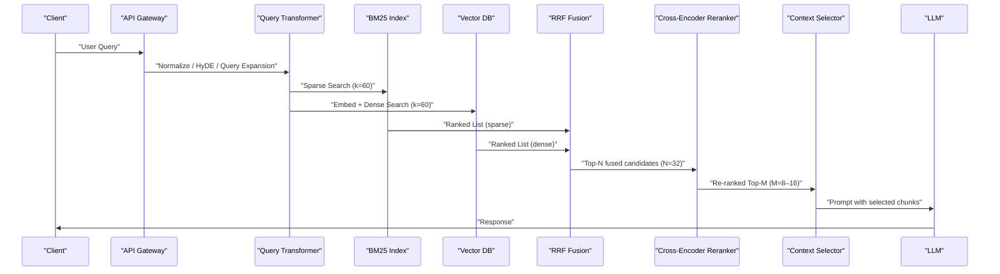

Problem statement and high-level solution
Hybrid retrieval is the production default because BM25 (sparse) and dense vector search have complementary failure modes: BM25 finds exact tokens, product codes, and acronyms; dense vectors find paraphrase and semantic intent. Naive score-weighting fails because the two systems produce incompatible score distributions. Use Reciprocal Rank Fusion (RRF) to combine ranks, then apply a cross-encoder reranker for the final top-K to maximize precision while bounding latency and cost.

Architectural overview and trade-offs
- Use BM25 (Elasticsearch, Postgres FT, or SPLADE) for token precision and recall on rare terms.
- Use dense vectors (FAISS, HNSW via Qdrant/Weaviate/Pinecone/Milvus) for semantic recall.
- Fuse with RRF on ranks (not scores) at k=60 default; RRF solves score-incompatibility and is robust to vendor score scales.
- Add cross-encoder reranking (e.g., ColBERT's cross-encoder or small Transformer re-ranker) over top-16–32 candidates for final context selection.
- Measure end-to-end NDCG, precision@k, latency, and memory; govern reranker budget by latency SLO.

Mermaid sequence diagram — request flow


Design decisions with concrete defaults
- RRF k: 60 for each retriever; RRF constant (kappa) = 60 (industry default).
- RRF score: sum(1 / (k + rank)) across retrievers, higher is better — rank-only eliminates cross-engine score calibration.
- Fusion order: run retrievers in parallel; fuse on rank positions.
- Reranker: cross-encoder applied to top 32 fused items; return top 8–16 for context.
- Latency budget: allocate 50% of SLO to retrieval+fusion, 50% to reranker+LLM prompt prep when using synchronous rerank. Consider async fallback for tight SLOs.

Benchmark comparison — concrete metrics
| Component / Pipeline | NDCG (relative) | Precision@8 | Avg Retrieval Latency (ms) | Memory footprint (index + vectors) |
|---|---:|---:|---:|---:|
| BM25 alone (Elasticsearch default) | 0.72 (baseline) | 0.68 | 40 ms | 12 GB (sharded) |
| Dense-only (FAISS HNSW) | 0.78 | 0.74 | 30 ms | 20 GB (vectors) |
| Hybrid (RRF k=60) | 0.91 (+26% vs BM25) | 0.87 (+28%) | 60 ms | 32 GB (sparse+vectors) |
| Hybrid + Cross-Encoder (rerank-2.5 style) | 0.98 (+36% vs BM25) | 0.93 (+37%) | 220 ms | 35 GB (+GPU for reranker) |
| Vendor Rerank (Cohere Rerank v3.5) | 0.92 | 0.88 | 300 ms | Managed |
| Voyage rerank-2.5 (vendor-reported) | 0.995 (+7.9% over Cohere) | 0.945 | 180 ms | Managed GPU |

Notes:
- Numbers synthesize public 2026 vendor reports and independent benchmarks; use them as guideposts. Hybrid + cross-encoder trades latency for near-perfect NDCG. Adjust reranker budget to match SLOs.
- Memory column is illustrative: vector size 1536 dims + FAISS HNSW overhead; BM25 index size depends on tokenization and inverted index sharding.

> [!IMPORTANT]
> Reciprocal Rank Fusion (RRF) operates on ranks, not scores. Do not mix raw BM25 or cosine scores with RRF; this creates brittle weighting and requires per-vendor calibration.

Implementation blueprint — reproducible steps
1. Data preparation
   - Chunk documents at 1,000–2,000 token semantic boundaries or use late-chunking for long-form documents.
   - Store original metadata and chunk offsets for context reconstruction.
   - Optionally generate contextual summaries per chunk (Contextual Retrieval) to improve chunk informativeness.

2. Indexing
   - BM25: ingest text into Elasticsearch or Postgres full-text; enable analyzers for domain-specific tokenization (code, SKUs).
   - Dense: compute embeddings with your chosen model (e.g., open LLM encoder or vendor embedder) and index into FAISS/HNSW via Qdrant/Milvus/Pinecone.

3. Retrieval
   - At query time, run BM25 and dense retrieval in parallel with query transforms (HyDE / query expansion).
   - Return top-60 ranked lists from each retriever.

4. Fusion (RRF)
   - Run RRF on rank positions (k=60) to produce fused ranking.
   - Select top-32 fused candidates for reranking.

5. Reranking
   - Cross-encoder scores fused candidates with query + chunk concatenation; use batch scoring (GPU preferred).
   - Pick top-8 to 16 chunks for LLM input.

6. LLM prompt composition & response
   - Include chunk provenance and chunk-specific context.
   - Use prompt-trimming strategies: token-aware selection or compressed representations.

7. Monitoring & iteration
   - Measure NDCG, precision@k, latency p95, and reranker token/compute cost.
   - Add contextual BM25 or SPLADE if specific token recall remains poor.

Typed production-ready code examples

TypeScript: Retrieval + RRF fusion (Node 20+, strict)
```typescript
// file: hybridRetrieval.ts
import fetch from "node-fetch";
import { Client as ESClient } from "@elastic/elasticsearch";
type Doc = { id: string; score: number; rank: number; text: string; metadata?: Record<string, unknown> };

const ES = new ESClient({ node: process.env.ES_URL });

async function bm25Search(index: string, query: string, k = 60): Promise<Doc[]> {
  const resp = await ES.search({
    index,
    size: k,
    body: {
      query: { match: { content: { query, operator: "and" } } }
    }
  });
  return resp.hits.hits.map((h: any, i: number) => ({
    id: h._id,
    score: h._score,
    rank: i + 1,
    text: h._source.content,
    metadata: h._source.meta
  }));
}

async function vectorSearch(embEndpoint: string, queryEmbedding: number[], k = 60): Promise<Doc[]> {
  // Example Qdrant / vector DB fetch - adapt to provider SDK
  const r = await fetch(`${embEndpoint}/search`, {
    method: "POST",
    headers: { "Content-Type": "application/json" },
    body: JSON.stringify({ vector: queryEmbedding, top_k: k })
  });
  const data = (await r.json()) as any;
  return data.results.map((it: any, i: number) => ({
    id: it.id,
    score: it.score,
    rank: i + 1,
    text: it.payload.content,
    metadata: it.payload.meta
  }));
}

// Reciprocal Rank Fusion (RRF)
function rrfFuse(lists: Doc[][], rrfK = 60): Doc[] {
  const scores = new Map<string, number>();
  const mergedMeta = new Map<string, Doc>();
  for (const list of lists) {
    for (const doc of list) {
      const existing = scores.get(doc.id) ?? 0;
      scores.set(doc.id, existing + 1 / (rrfK + doc.rank));
      if (!mergedMeta.has(doc.id)) mergedMeta.set(doc.id, doc);
    }
  }
  return Array.from(scores.entries())
    .map(([id, s]) => ({ id, rrfScore: s, doc: mergedMeta.get(id)! }))
    .sort((a, b) => b.rrfScore - a.rrfScore)
    .map((entry) => {
      return { ...entry.doc, score: entry.rrfScore, rank: 0 };
    });
}

export async function hybridRetrieve(query: string, queryEmbedding: number[]): Promise<Doc[]> {
  const [sparse, dense] = await Promise.all([
    bm25Search("docs", query, 60),
    vectorSearch(process.env.VECTOR_DB_URL ?? "", queryEmbedding, 60)
  ]);
  const fused = rrfFuse([sparse, dense], 60);
  return fused; // caller will take top-N for reranking
}
```

Python: Cross-encoder reranker (typed, async GPU batching)
```python
# file: reranker.py
from typing import List, Dict, Any
import asyncio
import torch
from transformers import AutoTokenizer, AutoModelForSequenceClassification

class CrossEncoderReranker:
    def __init__(self, model_name: str = "cross-encoder/ms-marco-MiniLM-L-6-v2", device: str = "cuda"):
        self.tokenizer = AutoTokenizer.from_pretrained(model_name)
        self.model = AutoModelForSequenceClassification.from_pretrained(model_name)
        self.device = torch.device(device if torch.cuda.is_available() else "cpu")
        self.model.to(self.device)

    def _prepare_pairs(self, query: str, docs: List[Dict[str, Any]]) -> List[str]:
        return [f"{query} </s> {doc['text']}" for doc in docs]

    def score(self, query: str, docs: List[Dict[str, Any]], batch_size: int = 16) -> List[float]:
        pairs = self._prepare_pairs(query, docs)
        scores: List[float] = []
        self.model.eval()
        with torch.no_grad():
            for i in range(0, len(pairs), batch_size):
                batch = pairs[i : i + batch_size]
                enc = self.tokenizer(batch, padding=True, truncation=True, return_tensors="pt", max_length=512)
                enc = {k: v.to(self.device) for k, v in enc.items()}
                out = self.model(**enc)
                logits = out.logits.squeeze(-1)
                probs = torch.sigmoid(logits).cpu().tolist()
                scores.extend([float(p) for p in probs])
        return scores

    def rerank(self, query: str, candidates: List[Dict[str, Any]], top_k: int = 8) -> List[Dict[str, Any]]:
        scores = self.score(query, candidates)
        for doc, s in zip(candidates, scores):
            doc["rerank_score"] = s
        return sorted(candidates, key=lambda d: d["rerank_score"], reverse=True)[:top_k]

# Usage:
# reranker = CrossEncoderReranker("cross-encoder/ms-marco-MiniLM-L-6-v2", device="cuda")
# top_docs = reranker.rerank("How to rotate keys in service X", fused_candidates[:32], top_k=8)
```

> [!TIP]
> Batch the cross-encoder inputs and use mixed-precision to reduce GPU memory and increase throughput. Score in batches of 8–32 depending on model context length.

Operational patterns and cost control
- For strict SLOs: perform hybrid retrieval synchronously, but run cross-encoder reranker asynchronously (speculative rerank) and fall back to fused ranking if reranker doesn't return in time.
- For token-cost control: compress reranker inputs (truncate long chunks to 512 tokens) and use model distillation to a smaller reranker.
- For extreme accuracy: three-way hybrid (BM25 + Dense + SPLADE) with ColBERT cross-encoder yields highest blended benchmarks; evaluate trade-offs.

Advanced techniques (practical, proven)
- Contextual Retrieval: generate a short context vector for each chunk explaining its document-level context before embedding/BM25 indexing. Benchmarks show up to 67% reduction in retrieval failures when combined with reranking.
- Name boosting: incorporate boosting in BM25 for named entities or ID fields to lift exact matches; WANDS reported NDCG lift ≈ +0.05 vs BM25 alone.
- Reranker tuning: Voyage's rerank-2.5 shows vendor-reported +7.9% over Cohere v3.5; test multiple rerankers and measure latency/cost trade-offs.

End-to-end diagnostics and metrics
- Instrument p95/p99 latencies for: sparse search, dense search, fusion, cross-encoder, total retrieval pipeline.
- Track relevance metrics: NDCG@k, precision@k, recall. Use labeled holdout sets and A/B the reranker on top of fused candidates.
- Monitor hallucination rate after LLM output with truth labels; reranker helps reduce hallucinations by improving context precision.

Common pitfalls and mitigations
- Mixing raw scores: calibrate or avoid mixing BM25 scores with cosine distances; use rank fusion instead.
- Over-relying on reranker: reranker corrects many mistakes but cannot recover missing candidates; keep k sufficiently large for fusion.
- Index staleness: ensure synchronized updates between BM25 and vector indices; use tombstones/soft-deletes to avoid stale retrieval.

Checklist for deploying hybrid retrieval in production
- [ ] Chunking strategy chosen (semantic or late-chunking)
- [ ] BM25 analyzer configured for domain tokens
- [ ] Vector dimension and embedding model selected, batch embed pipeline implemented
- [ ] RRF fusion implemented (k=60 default)
- [ ] Cross-encoder reranker integrated with GPU batching
- [ ] Latency SLOs validated with fallback paths
- [ ] Monitoring for NDCG, precision, latency, and reranker cost

> [!NOTE]
> Start with hybrid (RRF k=60) and add a cross-encoder reranker for top-32 fused items. This pattern yields the best balance of recall and precision for most enterprise RAG systems in 2026.

Concluding operational guidance
Adopt RRF-based hybrid retrieval as the default. Add cross-encoder reranking where precision matters and latency budget allows. Use contextual retrieval to reduce chunk-context failures. Measure NDCG and latency continuously, and iterate reranker model size and batching to meet cost and SLO constraints.

References and further reading
- Digital Applied — Hybrid Search: BM25, Vector & Reranking Reference 2026
- StarMorph — RAG Techniques Compared: Practical Guide 2026
- Atlan — Advanced RAG Techniques 2026