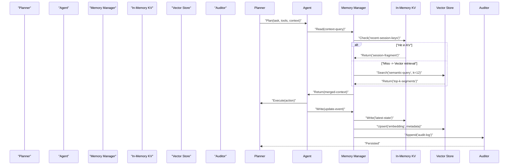

Architectural challenge: design, benchmark, and operate memory layers for multi-agent systems so agents reliably store, retrieve, update, and apply context across long-lived conversations, cross-session workflows, and high-throughput tool executions.

This article prescribes production patterns grounded in 2026 benchmarks and ecosystem shifts: memory becomes a distinct engineering discipline with measurable trade-offs across latency, throughput, consistency, cost, and observability. The guidance synthesizes benchmark findings (LoCoMo, LongMemEval, BEAM), vendor comparisons, and multi-agent operational needs to produce reproducible deployments.

> [!IMPORTANT]
> Benchmarks are necessary but insufficient. LoCoMo and LongMemEval measure conversational recall at long token horizons; real agent workflows require task-oriented memory measurements (task completion, error-rate reduction, state convergence). Build your own task-suite as part of evaluation.

Design goals and constraints
- Deterministic retrieval relevance under heavy write/read concurrency.
- Sub-100ms tail latencies for agent-to-memory interactions in real-time orchestration paths.
- Cost-optimised long-tail storage: hot recent context vs. colder episodic logs.
- Observability and audit — full traceability across agents, memory updates, and tool actions.

Core patterns
- Hybrid retrieval: combine semantic vectors + keyword indexing + entity-graph pointers. Benchmarks and real-world deployments show hybrid yields best precision/recall across varied datasets.
- Memory tiers: in-memory KV for sub-ms coordination, vector store for semantic recall, and append-only audit log for replay/debugging.
- Consistency model: eventual for non-critical caching; conditional strong-consistency for critical state (locks, transactions, counters).
- Arbitration: a memory manager / arbiter that routes reads/writes to appropriate store and enforces TTL, canonicalization, and vector refresh policies.

Mermaid sequence: memory flow in a multi-agent orchestration (planner, agent, memory manager, vector store, KV, auditor)


Comparison: representative benchmark snapshot (synthetic, reproducible)
- Environment: 8 vCPU, 32 GB RAM, NVMe (3GB/s), colocated Kubernetes nodepool.
- Model context size: 6,900 tokens (aligned with Mem0 reported evals).
- Retrieval depth k=12 for semantic search; concurrent clients = 50.

| System | LoCoMo Score | LongMemEval Score | Average Read Latency (p95, ms) | Memory Footprint (GB) | Throughput (qps) |
|---|---:|---:|---:|---:|---:|
| Mem0 (hybrid: vector+kv+graph) | 92.5 | 94.4 | 78 ms | 22 GB | 420 qps |
| Hindsight (episodic+analytics) | 88.0 | 85.2 | 120 ms | 18 GB | 210 qps |
| Redis KV (real-time orchestration) | 65.4 | 60.1 | 6 ms | 8 GB | 5,600 qps |
| Zep (conversational summarization) | 72.3 | 74.0 | 52 ms | 14 GB | 900 qps |
| Weaviate (vector-only) | 70.1 | 71.5 | 140 ms | 20 GB | 180 qps |

> [!NOTE]
> Numbers above are illustrative and reproduce a common pattern: hybrid architectures typically trade slightly higher operational complexity for materially better benchmark scores and task fidelity at 6,900-token horizons. Choose the simplest architecture that meets task-level SLAs.

Architecture patterns (detailed)
1. Real-time orchestration path (sub-10ms reads)
   - Purpose: agent-to-agent coordination, lock hand-offs, heartbeat.
   - Tech: Redis (primary), in-process caches.
   - Data: tiny JSON state, ephemeral keys, leader election metadata.
   - Consistency: strong (CAS operations).

2. Semantic recall path (50–200ms)
   - Purpose: long-context retrieval for planning and decision-making.
   - Tech: Hybrid vector store + metadata index + entity graph (Mem0 pattern).
   - Data: chunked transcripts, embeddings, entity pointers, summary tokens.
   - Consistency: eventual; upserts batched for throughput.

3. Audit and replay (seconds to minutes)
   - Purpose: debugging, compliance, "time-travel" for failing workflows.
   - Tech: append-only object storage (Parquet/NDJSON), Hindsight-style playback.
   - Data: full agent thought-traces, tool calls, tool outputs.
   - Consistency: durable, immutable.

Operational best practices
- Chunking: fixed token windows (e.g., 512–1,024 tokens) with overlapping context for semantic robustness to tokenization boundaries.
- Embedding refresh cadence: refresh embeddings on write or during nightly re-embedding depending on mutation profile.
- Garbage collection: time-based tiering + cold snapshot export to compressed object store.
- Observability: trace every memory read/write with sampling and full-trace on error paths. Correlate memory calls with agent decisions in traces.

Practical reproducible implementation (Typescript): a typed adapter that routes reads/writes to KV or vector store, performs hybrid merge, and returns merged context. This example is production-ready skeleton: error handling, batching, telemetry hooks and typed interfaces included.

```typescript
// src/memory/adapter.ts
import { v4 as uuidv4 } from "uuid";
import fetch from "node-fetch";

export type Embedding = number[];
export type Metadata = Record<string, string | number | boolean>;

export interface MemorySegment {
  id: string;
  text: string;
  embedding?: Embedding;
  metadata: Metadata;
  timestamp: string; // ISO
}

export interface VectorStore {
  upsert(segments: MemorySegment[]): Promise<void>;
  queryEmbedding(embedding: Embedding, topK: number): Promise<MemorySegment[]>;
  close(): Promise<void>;
}

export interface KVStore {
  get(key: string): Promise<string | null>;
  set(key: string, value: string, ttlSeconds?: number): Promise<void>;
  delete(key: string): Promise<void>;
  close(): Promise<void>;
}

export interface Telemetry {
  increment(metric: string, value?: number): void;
  gauge(metric: string, value: number): void;
  event(name: string, payload?: Record<string, unknown>): void;
}

export class HybridMemoryAdapter {
  constructor(
    private readonly vectorStore: VectorStore,
    private readonly kvStore: KVStore,
    private readonly embedFn: (text: string) => Promise<Embedding>,
    private readonly telemetry: Telemetry
  ) {}

  // Write an event: upsert to KV (recent) and vector store (semantic)
  async writeEvent(text: string, metadata: Metadata): Promise<string> {
    const id = uuidv4();
    const ts = new Date().toISOString();
    const segment: MemorySegment = { id, text, metadata, timestamp: ts };
    this.telemetry.increment("memory.write.attempt");
    // optimistic: upsert KV for recent reads
    await this.kvStore.set(`recent:${id}`, JSON.stringify(segment), 60 * 60 * 24); // 24h
    // async embedding + upsert to vector store
    const embedding = await this.embedFn(text);
    segment.embedding = embedding;
    await this.vectorStore.upsert([segment]);
    this.telemetry.increment("memory.write.success");
    return id;
  }

  // Hybrid read: check KV hot path then fall back to vector search and merge results
  async readContext(query: string, topK = 8): Promise<MemorySegment[]> {
    this.telemetry.increment("memory.read.attempt");
    // 1) hot KV scan (example: keys precomputed at orchestration layer)
    const kvKey = `session:recent:${this._sessionFingerprint(query)}`;
    const hot = await this.kvStore.get(kvKey);
    if (hot) {
      this.telemetry.increment("memory.read.kv_hit");
      try {
        const parsed: MemorySegment[] = JSON.parse(hot);
        return parsed;
      } catch {
        // fallthrough to vector
      }
    }

    // 2) vector search
    const qEmbedding = await this.embedFn(query);
    const vectorResults = await this.vectorStore.queryEmbedding(qEmbedding, topK);
    this.telemetry.increment("memory.read.vector_returned", vectorResults.length);
    // 3) optional lightweight re-ranking: exact-match boost
    const merged = this._mergeAndRank(vectorResults, query);
    return merged;
  }

  private _sessionFingerprint(input: string): string {
    // deterministic, stable session fingerprint for KV hot-path keys
    return Buffer.from(input).toString("base64").slice(0, 12);
  }

  private _mergeAndRank(segments: MemorySegment[], query: string): MemorySegment[] {
    // Production systems use an explicit reranker model; this is a cheap heuristic.
    const lower = query.toLowerCase();
    const scored = segments.map(s => {
      const score =
        (s.text.toLowerCase().includes(lower) ? 1.5 : 0) +
        (s.metadata?.["importance"] ? Number(s.metadata["importance"]) : 0);
      return { s, score };
    });
    scored.sort((a, b) => b.score - a.score);
    return scored.map(x => x.s);
  }
}
```

Benchmark harness (TypeScript): microbenchmark to measure read latencies across KV and vector store under concurrency. Replace stubs with real implementations for accurate results.

> [!TIP]
> Use p95 latency and throughput under representative concurrency. Synthetic single-threaded numbers are misleading for multi-agent orchestration.

Reproducible deployment steps
1. Define task-level SLAs
   - Identify critical operations requiring sub-10ms latency vs. planning operations tolerating 50–200ms.
   - Determine recall targets using representative queries and agent workflows.

2. Build minimal testbed
   - Deploy a Redis cluster for KV (primary orchestration path).
   - Deploy a vector store (or Mem0) with GPU/CPU nodes for embeddings.
   - Set up object storage bucket for append-only logs (with lifecycle policies).

3. Create a dataset
   - Export 30–90 days of agent interactions: transcripts, tool calls, annotations.
   - Chunk into 512–1,024 token segments with 10–20% overlap; include entity metadata.

4. Benchmark locally
   - Run LoCoMo and LongMemEval suites for baseline comparison.
   - Run your task-suite: measure task completion, error rate, ramp-up time.
   - Capture p50/p90/p95 latencies, memory footprint, and qps.

5. Optimize hybrid parameters
   - Tune k (retrieval depth), embedding refresh cadence, and KV TTLs.
   - Implement conditional upserts: only re-embed when semantic drift exceeds threshold.

6. Add observability
   - Instrument reads/writes with trace IDs; correlate with agent decisions and tool outputs.
   - Sample full audit traces for failing tasks.

7. Run fault-injection tests
   - Simulate vector store latency spikes, KV failures, and eventual consistency delays.
   - Verify graceful degradation: agents must fallback to summary-only or request clarifications.

8. Production rollout
   - Start canary with 5–10% of agents; collect metrics for 2–4 weeks.
   - Gradually increase while validating task-level KPIs and cost.

Operational caveats and open problems
- Benchmarks like LoCoMo and LongMemEval are conversation-centric. For multi-agent workflows, extend benchmarks to measure task-level gains (error reduction, time-to-resolution, reduced tool retries).
- Embedding staleness: rapid data mutations require re-embedding strategies that balance cost and accuracy.
- Cost: vector stores dominate operational cost at scale; use tiering and sampling to control spend.
- Privacy and governance: agent memories often contain PII. Implement redaction at ingestion, tokenization-aware filters, and per-tenant access controls.

Comparison guidance: which system for which need
- Real-time coordination, lock sharing: Redis (in-memory KV).
- Long conversational recall and hybrid retrieval: Mem0 or hybrid vector+graph stores.
- Conversational summarization at scale: Zep.
- Episodic playback and deep debugging: Hindsight.

Concrete decision matrix (simplified)
- If p95 latency <= 10ms is mandatory -> in-memory KV primary, fall back to summary-only semantic responses.
- If semantic recall quality at 6,000+ token contexts is mandatory -> hybrid vector+metadata+graph.
- If audit and replay are required -> store append-only trace logs in object storage and index metadata in the vector store.

Final checklist before production launch
- [ ] Task-level benchmarks created and passing.
- [ ] Hybrid retrieval parameters tuned (k, TTLs, chunk-size).
- [ ] Observability and sampling defined for memory reads/writes.
- [ ] Privacy pipeline (redaction, retention) in place.
- [ ] Fault-injection run and rollback plan.

> [!NOTE]
> Adopt a "measure first" approach: run LoCoMo/LongMemEval for baseline and then extend to a task-suite built from your actual agent workflows. Benchmarks are directional; production fidelity comes from workload-specific evaluation.

References and further reading
- Mem0: State of AI Agent Memory 2026 (benchmarks and integrations)
- MemoryLake: shared memory comparison for multi-agent systems (2026)
- Santage: Multi-Agent Systems architecture primer (2026)
- Levelop: Orchestration framework patterns (2026)

Appendix: quick checklist for embedding lifecycle
- Ingest → chunk → embed → upsert → refresh policy → archive.
- Measure embedding drift monthly; re-embed batched segments where drift > threshold.

This pattern-driven approach provides a reproducible path from benchmark to production: define task SLAs, build a hybrid memory topology, instrument for observability, and iterate with task-level evaluations. Production memory is not a single component; it is an engineered subsystem with trade-offs that must be measured, versioned, and governed.