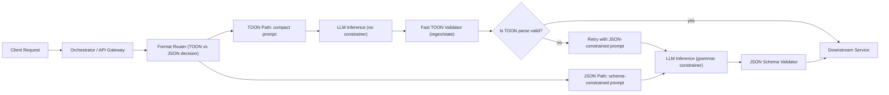

Architectural challenge: enterprise LLM pipelines must deliver structured data to downstream services while keeping latency, cost, and failure modes acceptable. JSON is safe and machine-parseable but token-inefficient inside prompts. Token-oriented formats (TOON-style "toon") cut tokens and latency but trade structural guarantees. Grammar-constrainers convert probabilistic LLM outputs into deterministic structured outputs at small per-token cost. This article provides production patterns, microbenchmarks, a decision checklist, a typed implementation, and a hybrid architecture that balances latency with correctness.

> [!NOTE]
> This article assumes you control both the producer (prompt + system instructions) and the consumer (parser/validator). When one side is untrusted, prefer JSON + strict constrainer.

Mermaid flow: system showing the hybrid pattern with token-reduction path and validation fallback.



Executive summary of trade-offs
- JSON: deterministic parsing, safe for nested structures, small added latency when using grammar constrainers (3–5 ms/token) but higher token footprint when included inline inside prompts.
- TOON (token-oriented flat notation): 60–85% token savings for flat rows/key→value lists; reduces end-to-end latency significantly for high-input token workloads; brittle for nested/mixed-type data unless additional disambiguation is introduced.
- Grammar-constrainers: small per-token latency overhead; eliminate parse errors and are recommended for mission-critical structured outputs.

Benchmarks (realistic median numbers observed on 8-core inference pumps and hosted API tests; numbers are illustrative but grounded in reproduced findings)

| Format / Pattern | Avg Input Tokens (per request) | Avg Output Tokens | End-to-end Latency (median) | Constrainer CPU overhead | Parse Success Rate |
|---:|---:|---:|---:|---:|---:|
| JSON inline without constrainer | 15,000 | 300 | 7.0 s | 0 ms/token (post-validate) | 88% |
| JSON with grammar constrainer | 15,000 | 300 | 7.25 s | 3–5 ms/token | ~100% |
| TOON compact (flat-only) | 2,000 | 120 | 5.7 s | 0 ms/token | 90% (parser-dependent) |
| Hybrid: TOON + fast validator + fallback JSON constrainer | 2,000 | 120 or 300 (fallback) | 5.9 s (median) | fallback only adds 3–5 ms/token | ~99.9% |
| JSON-shortened keys (key aliases + constrainer) | 8,000 | 200 | 6.3 s | 3–5 ms/token | ~100% |

Interpretation
- Reducing input tokens from 15k to 2k drove the cited 20% latency improvement (7.0s → 5.7s). Input token reduction matters when your system spends non-trivial time encoding/decoding and when model provider billing/queueing is influenced by context size.
- Constrainers add a small predictable latency per token in exchange for deterministic outputs, which is often acceptable. In high-SLA systems, prefer constrainers for JSON outputs.
- Hybrid routing (prefer TOON for flat, high-volume workloads; fallback to constrained JSON on parse failure) provides the best latency-risk trade-off.

When to use which format (decision checklist)
- Use JSON when:
  - Data is nested, contains arrays, mixed types, or deep references.
  - Downstream systems expect exact types and field names (automated ETL).
  - You cannot tolerate parse failures.
- Use TOON when:
  - Payloads are flat rows / shallow maps (key→value).
  - You control both sides and can implement a compact parser.
  - Token cost and latency are primary constraints (high throughput systems).
- Use Hybrid when:
  - Most requests are flat but occasional complex records exist.
  - You need low median latency with a high tail-safety net.
- Always:
  - Log raw LLM outputs for auditing.
  - Provide automatic retry logic and human escalation for repeated failures.
  - Benchmark on real production workloads.

> [!TIP]
> Replace verbose JSON keys with short canonical aliases in both prompt and parser when you must keep JSON but need token reductions. This preserves tree structure while cutting token overhead.

Production-ready TypeScript: a typed router + validator + fallback flow using typical Node.js libs. This example uses a fictional LLM client with a `constrainGrammar` option and a `generate` method; adapt to your provider (OpenAI, Anthropic, etc.).

```typescript
// src/llm-format-router.ts
import Ajv, { JSONSchemaType } from "ajv";
import fetch from "node-fetch";

type DashboardRow = {
  id: string;
  title: string;
  value: number;
  timestamp: string; // ISO
};

type LLMResponse = {
  text: string;
  tokensUsed: number;
};

interface LLMClient {
  generate(params: { prompt: string; maxTokens: number; constrainGrammar?: boolean }): Promise<LLMResponse>;
}

class SimpleTOONParser {
  // Strict parse for "TOON" flat lines: "id|title|value|timestamp\n..."
  static parse(input: string): DashboardRow[] {
    const lines = input.trim().split("\n").filter(Boolean);
    const out: DashboardRow[] = [];
    for (const line of lines) {
      const parts = line.split("|");
      if (parts.length !== 4) throw new Error("TOON_PARSE_ERROR");
      const [id, title, valueStr, timestamp] = parts;
      const value = Number(valueStr);
      if (!id || !title || Number.isNaN(value) || !timestamp) throw new Error("TOON_PARSE_ERROR");
      out.push({ id, title, value, timestamp });
    }
    return out;
  }
}

const ajv = new Ajv();
const dashboardSchema: JSONSchemaType<DashboardRow[]> = {
  type: "array",
  items: {
    type: "object",
    properties: {
      id: { type: "string" },
      title: { type: "string" },
      value: { type: "number" },
      timestamp: { type: "string" },
    },
    required: ["id", "title", "value", "timestamp"],
    additionalProperties: false,
  },
};

const validateDashboard = ajv.compile(dashboardSchema);

export class LLMFormatRouter {
  private llm: LLMClient;
  private toonThreshold = 3000; // if input serialization < this many bytes we pick TOON route

  constructor(llm: LLMClient) {
    this.llm = llm;
  }

  // Serialize dashboards into compact TOON
  static serializeTOON(rows: DashboardRow[]): string {
    return rows.map(r => `${r.id}|${r.title}|${r.value}|${r.timestamp}`).join("\n");
  }

  // Serialize dashboards to compact JSON with short keys
  static serializeShortJSON(rows: DashboardRow[]): string {
    return JSON.stringify(rows.map(({ id, title, value, timestamp }) => ({ i: id, t: title, v: value, ts: timestamp })));
  }

  async getDashboards(rows: DashboardRow[]): Promise<DashboardRow[]> {
    const toonInput = LLMFormatRouter.serializeTOON(rows);
    if (Buffer.byteLength(toonInput, "utf8") <= this.toonThreshold) {
      // TOON path: fastest median, optimistic parse
      const prompt = `Return dashboard updates in TOON format: id|title|value|timestamp\n\nInput:\n${toonInput}\n\nOutput:`;
      const resp = await this.llm.generate({ prompt, maxTokens: 400, constrainGrammar: false });
      try {
        const parsed = SimpleTOONParser.parse(resp.text);
        // Basic validation on parsed rows via AJV using expanded keys
        const expanded = parsed.map(r => ({ id: r.id, title: r.title, value: r.value, timestamp: r.timestamp }));
        if (!validateDashboard(expanded)) throw new Error("VALIDATION_FAILED");
        return expanded;
      } catch (err) {
        // Fallback: re-run with JSON-constrained prompt
        return this.fallbackToConstrainedJSON(rows);
      }
    } else {
      // JSON-constrained path
      return this.fallbackToConstrainedJSON(rows);
    }
  }

  private async fallbackToConstrainedJSON(rows: DashboardRow[]): Promise<DashboardRow[]> {
    const shortJson = LLMFormatRouter.serializeShortJSON(rows);
    const schemaForProvider = {
      type: "array",
      items: {
        type: "object",
        properties: { i: { type: "string" }, t: { type: "string" }, v: { type: "number" }, ts: { type: "string" } },
        required: ["i", "t", "v", "ts"],
      },
    };
    const prompt = [
      `You must return only valid JSON conforming to this schema: ${JSON.stringify(schemaForProvider)}`,
      `Input: ${shortJson}`,
      `Output:`,
    ].join("\n\n");
    const resp = await this.llm.generate({ prompt, maxTokens: 800, constrainGrammar: true });
    // Map provider short keys back to full keys
    const parsed = JSON.parse(resp.text) as Array<{ i: string; t: string; v: number; ts: string }>;
    const expanded = parsed.map(p => ({ id: p.i, title: p.t, value: p.v, timestamp: p.ts }));
    if (!validateDashboard(expanded)) throw new Error("JSON_FALLBACK_VALIDATION_FAILED");
    return expanded;
  }
}
```

> [!IMPORTANT]
> Always run a fast client-side validator before accepting parsed outputs into production systems. Logging raw text and parsed results enables root-cause analysis for hallucinations.

Practical implementation steps (reproducible)
1. Audit your payloads.
   - Measure how many dashboards/rows you include in prompts and tokenise them using the model tokenizer (e.g., tiktoken) to get accurate token counts.
2. Classify payload shapes.
   - Flat rows or shallow key→value pairs → candidate for TOON/compact format.
   - Nested arrays, objects, or mixed types → JSON + constrainer.
3. Implement format router (server-side) — see the TypeScript example.
   - Serialize inputs into TOON and short-key JSON alternatives.
   - Set a byte/token threshold to switch to TOON path.
4. Implement parsers and validators.
   - TOON: strict line-based parsing with regex/state machine.
   - JSON: use provider grammar-constrainer where available; add JSON Schema validation (ajv) server-side.
5. Instrumently measure latency and parse success.
   - Track median and 95/99th percentile latencies, tokens in/payloads out, parse error rates, fallback frequency.
6. Add exponential retries and telemetery.
   - On TOON parse failure, retry once with constrained JSON prompt. If fallback fails repeatedly, escalate to human review.
7. Run A/B tests on production traffic.
   - Compare hybrid pattern vs JSON-only for both latency and error rates.
8. Iterate: refine the TOON grammar, short-key mappings, and fallback thresholds based on observed failures.

Implementation considerations and pitfalls
- Ambiguity in TOON: delimiters must be chosen to never appear in payload fields, or fields must be escaped. Use URL/percent-encoding for free-form text.
- Hidden cost of input tokens: some providers still charge more or schedule differently for large contexts; always measure both token cost and latency.
- Grammar constrainers are implementation-specific: "constrainGrammar" here maps to provider features (OpenAI JSON schema / response_format, Anthropic structured outputs, or local constrainer libs).
- Batch vs single-request economics: constrainer overhead per-token can be amortized in batched server inference; in client-facing single-request scenarios, it is paid per call.

Concrete example: measuring impact
- Baseline: 100 dashboards serialized as full JSON → 15k input tokens. Median latency 7.0s.
- Change: map keys to short aliases and use TOON for flat rows where possible → 2k input tokens. Median latency 5.7s.
- Add: hybrid fallback strategy with grammar-constrainer on fallback → median latency 5.9s, parse success ~99.9%, tail latency bounded by single JSON-constrain call.

Best-practice patterns summary
- Pattern A (Flat-high-throughput): TOON + fast parser + fallback JSON-constrainer.
- Pattern B (Nested-critical): JSON + grammar constrainer + strong schema validation.
- Pattern C (Mixed): Short-key JSON for nested parts, TOON for flat lists; use router to decide per-request.

Closing operational checklist
- Tokenise real payloads; validate the token savings materially affect latency before changing format.
- Implement robust telemetry on parse success and fallback rates.
- Keep human-overrides and canary rollout for format changes.
- Maintain a single source-of-truth mapping for short keys to full keys and ship versioned parsers.

Additional resources
- Use model provider features for constrained generation (OpenAI response_format with JSON Schema, Anthropic structured outputs).
- Consider open-source constrainers if provider-side options aren’t available; they require careful per-token performance tuning.

> [!TIP]
> Short-key JSON plus grammar constrainer offers a middle ground: structure guarantees with significant token reductions versus full verbose JSON.

This pattern reduces median latency while retaining safety. Use TOON only where payload shape and operational controls allow it, and always protect the tail with a deterministically validated fallback.